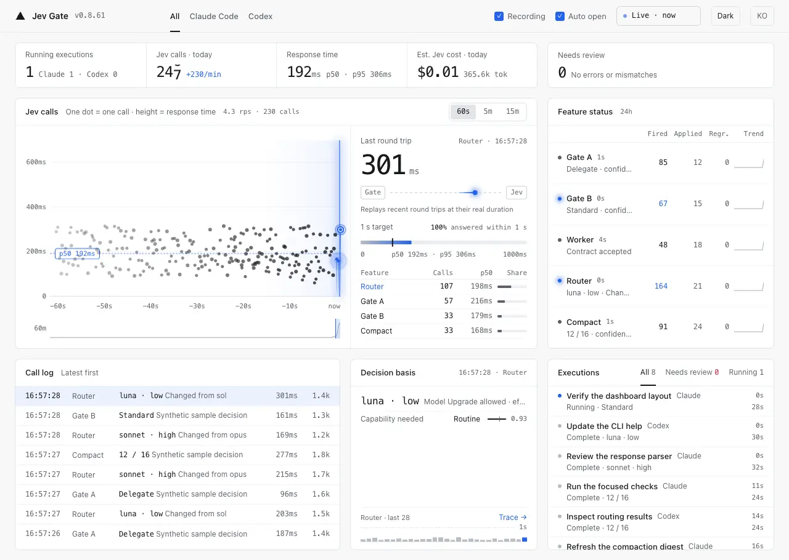

<div align="center">

<picture>
  <source media="(prefers-color-scheme: dark)" srcset="./assets/readme/jev-gate-logo-dark.svg">
  
</picture>

<br><br>

[](https://github.com/MongLong0214/jev-gate/actions/workflows/ci.yml)
[](https://github.com/MongLong0214/jev-gate/releases/latest)
[](#claude-code)
[](#codex)
[](package.json)

**Jev-assisted model routing, delegation for Claude Code and native Codex, plus context compaction for Claude Code and Codex.**

[Install](#install) · [Results](#results) · [How it works](#how-it-works) · [Dashboard](#read-the-live-dashboard) · [Data and privacy](#settings-and-data) · [Troubleshoot](#update-and-troubleshoot)

</div>

<h3 align="center">About half the cost. Same quality. Measured on real work.</h3>

<p align="center">
  <a href="#results"><picture>
    <source media="(prefers-color-scheme: dark)" srcset="./assets/readme/results-dark.svg">
    
  </picture></a>
</p>

<p align="center"><sub><i>Two real feature tasks, each a 17-turn Claude Code 2.1.294 session on Opus 5.5 (xhigh), with and without Jev Gate v0.8.15 defaults. Cost is the host's own total and includes Jev's requests; quality is blind-graded against the merged PRs. One pair per task: a pilot that shows a direction, not a guarantee — <a href="#results">method and limits</a>.</i></sub></p>

<h3 align="center">Every decision and its result, live.</h3>

<p align="center">
  <a href="#read-the-live-dashboard"><picture>
    <source media="(prefers-reduced-motion: reduce) and (prefers-color-scheme: dark)" srcset="./assets/readme/dashboard-still-dark.webp">
    <source media="(prefers-reduced-motion: reduce)" srcset="./assets/readme/dashboard-still.webp">
    <source media="(prefers-color-scheme: dark)" srcset="./assets/readme/dashboard-dark.webp">
    
  </picture></a>
</p>

<p align="center"><sub><i>Sample data. One local dashboard for Claude Code and Codex opens on its own: each Jev judgment lights the feature it decided, with its run, reply time and observed result — <a href="#read-the-live-dashboard">how to read it</a>.</i></sub></p>

# Jev Gate

Long coding sessions get expensive in a quiet way: one main context keeps growing, every request re-reads it from cache on the most capable model, and routine work — searching, running checks, reviewing — pays the same price as the hard part.

Jev Gate fixes the allocation, not the work. **Jev judges each turn; code applies the policy; your coding host executes it.** Simple, bounded work moves to a fast worker or a lighter model; hard reasoning stays where it belongs; old context is compacted to what the current task needs. One local dashboard shows every decision and its observed result for both hosts.

**Install the plugin and enter your Jev API key.** No project config, shell exports, trace-directory setup or dashboard terminal is required. Node.js 22+ and your host's native login are required.

## Results

### Cost, tokens, time and quality — measured

| | Claude Code alone | With Jev Gate | Change |
| --- | ---: | ---: | ---: |
| **Cost** (host-reported, incl. Jev requests) | $42.81 | **$19.65** | **−54%** |
| **Tokens** (all models and subagents) | 111.7 M | **41.3 M** | **−63%** |
| **Agent time** | 124 min | **65 min** | **−47%** |
| **Peak main context** | 442 K / 673 K | **206 K / 353 K** | about −50% |
| **Quality** (blind rubric, 23 points) | 21 | **21** | **same** |

**Per task** (cost, native → Jev Gate): feature with a strict backend contract **$15.58 → $7.76** (−50%); async UI interaction **$27.24 → $11.89** (−56%). Both pointed the same way. Even pricing Jev's own routing requests at Claude Opus rates, the savings stay at −42% and −54%.

**Quality is not traded for the saving.** Output was graded against the merged pull requests with a rubric frozen before any diff was read, by two graders who did not know which arm produced it. Every run had zero new type or lint errors and passed its own tests. The two arms were within half a point on each task, each ahead on one.

**Why it is cheaper.** The native sessions kept growing one main context (up to 673 K tokens) and re-read it from cache on every request — cache reads were 98 % of their tokens. With Jev Gate, exploration, test and review work went to Sonnet and Haiku subagents, which kept the main context at about half the size and cut cache reads to roughly a third.

**How it was run.** Two real tasks from a private production TypeScript frontend, each re-implemented from its parent commit: a form option with a strict backend contract, and a click-to-add-row interaction that waits for asynchronous recalculation. Each session is one task prompt plus 16 fixed follow-ups (checks, tests, review, an idle gap, a PR draft). Claude Code 2.1.294, `claude-opus-5-5` at `xhigh`, identical settings; the only difference is the plugin (v0.8.15, defaults). Cost is the host's own reported total, cross-checked against transcript token counts.

> **Read this before quoting a number.** This is a **pilot: one pair per task**. It shows a direction, not a guarantee. Session-to-session variance can be large, and savings depend on your tasks, settings and host. A multi-pair run is planned. [Method, per-cell data and deviations →](https://github.com/MongLong0214/jev-gate/tree/main/bench/results/long-session-pilot-2026-10-12)

## How it works

1. **Gate** reads a new request and decides whether to answer directly or hand the whole request to one background worker.
2. **Router** picks the model and effort for the main turn and for each eligible agent, from the candidates your host actually supports. Your explicit pins always win.
3. **Compact** keeps task-relevant context. Claude Code uses an extractive digest; Codex selectively omits obsolete plaintext from older tool results before eligible model and native compaction requests, preserving the native returned context.
4. **The dashboard** records each judgment, request and observed result, live.

If a key is missing, a judgment is invalid or slow, or a host fact is unavailable, Jev Gate keeps the native call. It never upgrades low confidence into a more expensive tier.

## Install

### Claude Code

In Claude Code:

```text
/plugin marketplace add MongLong0214/jev-gate
/plugin install jev-gate@jev-gate
```

Enter your Jev API key in the local screen that opens automatically. The plugin prepares its runtime settings. Restart Claude Code once if the startup notice asks: some host settings are read before plugins load. Existing explicit owner overrides are preserved and reported.

### Codex

Download the **Codex ZIP** from the [latest release](https://github.com/MongLong0214/jev-gate/releases/latest), extract it, then install the extracted directory:

```sh
codex plugin marketplace add /absolute/path/to/extracted-plugin
codex plugin add jev-gate@jev-gate-codex
```

Enter your key in the automatic local screen and use ordinary Codex in your project. The plugin discovers the workspace and automatically adds the official `openai_base_url` connection setting. The built-in `openai` provider, login, model and effort settings stay in place; no manual config editing is needed. Start a fresh Codex host after installation or upgrade; a running host retains its loaded endpoint. Review installed hooks in `/hooks` if Codex asks for native trust. Keep one Jev Gate installation enabled. Automatic connection was tested with Codex CLI 0.163.0 and Node 22.15+.

Both hosts share one private key and dashboard. Installing from source is for development; run `npm ci` and `npm run build` before registering the checkout. [Codex configuration and troubleshooting](plugins/codex/README.md).

## Features

| Feature | Behavior | Jev usage |
| --- | --- | --- |
| Gate | Chooses direct execution or one background worker. Code accepts only observed passing checks. | Eligible admission and allocation judgments |
| Router | Selects model and effort from supported candidates for the root or eligible agents. Explicit pins are respected. | New root tasks are assessed once; eligible Codex tool continuations can be assessed at subsequent inferences; mapped Claude workers are assessed once per turn |
| Compact | Claude Code builds an extractive digest; Codex selects obsolete plaintext from older tool results, preserving native context and recent evidence. | Bounded judgments; missing context, timeout or invalid output preserves the native path |
| Dashboard | Shows both hosts' recorded judgments, requests, and outcomes live. | Reads local metadata; makes no Jev requests |

Gate, Router, Compact, recording, and automatic dashboard opening default to **on**. Automatic Astra/Fable targets default to off; enable both hosts with `frontierEnabled: true` in `~/.config/jev-gate/config.json`; manually selecting a root model does not enable automatic restricted children. [Router options](mods/router/README.md).

Default Gate settings run one worker per admitted request with a depth floor of 0. Native permissions remain authoritative. Missing keys, invalid judgments, timeouts, or unavailable host facts preserve the native call.

Gate A asks once about the current request. `needs_context`, unclear context, and insufficient self-contained support have distinct reasons and stay direct; earlier prompts are not sent for a second judgment. Direct admission adds no model context. Orchestration guidance is added only to admitted jobs. Gate B distinguishes a confident failure to meet fast-tier requirements from uncertainty.

A worker result requires every reported check exactly once as `pass`, with its execution confirmed after the last observed change. Changed files with zero reported checks, failed or unrun checks, duplicates, and unverified passes are not accepted. The single-worker path has no planner check contract: these checks establish command execution, not complete requirement coverage. Reservations with no native execution identity are released with a missing-result reason at the next prompt or Stop. Native background executions remain reserved until their end is observed; a successful native TaskStop records `cancelled`.

Enabled does not mean every prompt delegates, routes, or compacts. The first Claude prompt may lack context usage for Gate admission. Simple bounded work can use a fast worker; broad or unclear tasks may remain direct. Jev probabilities are policy inputs, not measured success rates. No general speed, cost, or token saving is guaranteed.

Set the shared frontier switch in the ordinary config (merge this field into an existing file):

```json
{ "version": 5, "frontierEnabled": false }
```

`true` makes Claude Fable and Codex Astra eligible for automatic routing at their supported efforts. Jev still selects the model/effort pair for the task; explicit host pins remain authoritative. An explicit `false` overrides legacy `routerAllowFable` / `allowAstra` options. If the field is absent, legacy opt-ins remain compatible. The switch is reread at policy boundaries; an already selected manual root model is preserved.

## Keep talking while workers run

Owned workers dispatch in the background by default. New messages steer the main conversation without replacing the original job or its contracts. A launch receipt is separate from completion and contract acceptance.

Claude sends native completion notifications. Codex's coordinator can query `jev_agent` with `action: "status"` or explicitly cancel with `action: "cancel"` and the returned `agent_id`. Interrupting the main turn does not cancel an already running background worker. If Claude is busy with a foreground tool, use its native **Send now** shortcut; ordinary Enter may queue a message. [Background and host details](docs/advanced-usage.md).

### Understand model routing

The model picker establishes the baseline. Router reassesses each new root task; selecting Sonnet once does not lock future tasks to Sonnet. Jev judges the capability the work needs (mechanical, routine, complex, or an open problem when Fable/Astra is enabled) and the effort each candidate model would need; code maps that to one model per role and moves only when the probability clears the configured floors. The README for Router lists [every model and effort combination and when each is chosen](mods/router/README.md#how-a-move-is-decided). A Gate retry is served at least one role above the attempt that failed. Claude workers with a known native identity receive continuation effort proposals after spawn; their model is chosen once, at the spawn. On Claude Code 2.1.312, same-turn tool continuations retain the earlier effort despite those proposals: see the [supported boundary and known limitation](mods/router/README.md#context-timing-and-application), tracked in [#392](https://github.com/MongLong0214/jev-gate/issues/392). Root new-task selection and initial worker allocation are separate from that limitation. Codex can reassess model and effort after completed tool calls when the current contract and a visible assistant progress update are available. Each distinct inference is assessed at most once; retries reuse its decision. Missing continuation context retains the original whole-task decision, and an uncertain judgment keeps the native request. Gate B owns the initial allocation for Jev workers; eligible ordinary agents use Router.

Simple lookup and mechanical worker tasks prefer current Haiku in Claude or current account-listed Luna in Codex. New automatic targets exclude previous generations. Haiku 5.5 requires Claude Code 2.1.293 or later and supports effort; `xhigh`/`max` depend on thinking mode, so hooks offer its universally valid `low`/`medium`/`high` levels. Native host pins and account availability remain authoritative.

Every PR runs the `models` CI job against the official Claude model/effort documentation, Claude Code changelog, and OpenAI Codex catalog. Stale Claude facts fail CI and produce a `model-update-<PR>` patch artifact (`git apply model-update.patch`); unknown schemas, missing metadata, changed Codex roles or unsupported effort levels also fail. `npm run models:check` checks locally; `npm run models:update` updates the existing Claude fact table, retires superseded versions and requires a verified host release for new IDs. Codex uses the account's live catalog; CI exercises the same production selectors against the official public catalog. Review changes and run the normal checks before merging. This check runs on PRs only and does not publish a release.

“Do not edit” constrains work. “Do not delegate” keeps it in the main session. Neither pins a model or effort. An explicit instruction to keep a model or effort, and host pins, remain authoritative; text asking for a cheaper model or claiming routing is already decided does not move it (use `/model`). Router also considers observed cache usage; a proposal can be held to preserve a useful cache. [Model, cache, and pin behavior](mods/router/README.md).

## Read the live dashboard

The plugin opens **one shared local browser dashboard** automatically. Starting another Claude or Codex session reuses it instead of opening duplicate tabs. Select **Claude + Codex**, **Claude Code**, or **Codex** to inspect each host.

The top row shows running executions per host, today's Jev calls and calls per minute, the Jev response-time median and p95, a list-price cost estimate with input tokens, and executions that need review. **Jev calls** plots one dot per recorded call (height = response time) over 60 seconds, 5 or 15 minutes, with the median line and the last hour below. Beside it, the latest round trip replays Gate → Jev → Gate at its recorded duration, with the share answered within one second and each feature's calls, median and share. **Feature status** lists Gate A, Gate B, workers, Router and Compact (available for both hosts) with each one's latest decision, the same last-24-hour fired, applied and regression counts as doctor (full check in the row's tooltip) and an hourly trend. Missing measurements stay unknown.

Values and rows update as records arrive, independently of motion. A new call flashes its feature, ripples its dot and replays its round trip; at most six round trips run at once without delaying values, and idle is calm. Trace watchers read changed filenames incrementally, with polling as a fallback; SSE patches carry changed steps. Pause and disconnected streams freeze the view. Reduced motion disables flashes and round trips while values continue updating. Layouts fit 320 to 1920 px without horizontal page scrolling.

1. Start a task in your normal coding session.
2. Read **Feature status**. Select a feature to show only its calls in the **Jev call log**; selecting it again shows all.
3. Read the call log: the latest eight calls with time, feature, decision, response time and tokens. A request still awaiting its response counts up in place. Select a row to keep its **Decision basis** (the recorded questions, answers and confidence against the threshold, and the same feature's recent response times); select it again to follow the newest call.
4. Choose an execution to open its trace: every stage on a timeline with its duration and result, and the selected stage's recorded facts, model selection and observed response, and raw event. Billed credit is not returned by the Jev API, so cost is an estimate only.
5. Use the host switch and the execution filters (All, Needs review, Running) to narrow records. **Pause** holds the view while new calls are counted; resuming shows the latest state without replaying held calls. Korean/English and light/dark controls are available.

| Record | Meaning |
| --- | --- |
| Running | A recorded request or stage is still awaiting its result |
| Complete | The recorded stage completed; a policy decision alone is not whole-task completion |
| Error | A specific Jev, host, request-setting, or observed-model error was recorded |
| Unobserved | A needed fact is missing; success or failure cannot be inferred |
| Interrupted | User interruption was observed |
| Needs review | A failure that may still affect work: later records of the same operation also failed, or none followed yet (current impact unknown) |
| Past error | A failure followed by a success of the same operation, or caused by the request's own arguments; it stays in the history and is never shown as resolved |
| No execution record | No matching event is available for this feature and range |

Without a contract decision the worker stage reads **No verdict**, including plain native Agent results. A refused worker contract is an error labelled **Contract not met**, with a closed reason and the check ids (`#n`) it concerns, never the raw reply. A later host end appears as its own **Host ended** row and does not mark the run done.

**Router · Request preparation** means pre-request checks finished. It is neither a new Jev judgment nor a completed model response. The dashboard distinguishes **selected model/effort**, **host dispatch or API request**, and **observed response**. A selection or submitted request alone cannot prove which model answered. Missing response effort stays unknown. When Claude writes matching transcript evidence late, the existing response record can be updated after the hook returns; missing or ambiguous evidence remains unknown. Codex Compact separately records Jev selection, actual submitted requests and observed responses; omitted characters are not a measured total-token saving. Older records without request purpose remain unconfirmed.

Flashes, ripples and round trips mark recorded calls; the blinking live edge carries none. Response charts use measured Jev latency; motion is not a speed claim. Pause freezes the view; workers keep running. Reconnecting means the browser's event stream will retry. The latest 200 executions are listed; filters recompute displayed measurements and exclude earlier steps outside the range.

Dashboard and recording controls are independent and default to on. Both hosts use the same preferences. Turning recording off leaves Jev features running. Turning automatic dashboard opening off stops the managed server; a manually started view remains available.

```sh
node "<Claude plugin path>/dist/cli.js" dashboard on|off|status
node "<Claude plugin path>/dist/cli.js" recording on|off|status
# Codex packages use dist/cli.mjs.
```

Preferences live under `~/.config/jev-gate` (`$XDG_CONFIG_HOME` supported). No preferences file is needed for normal use. [Dashboard diagnostics and recorded-data limits](docs/advanced-usage.md#doctor-and-explain).

## Settings and data

Configure Claude options under `/plugin` → jev-gate → configure. Plugin options belong in **user settings**; project `pluginConfigs` are ignored by the host. Optional Codex settings are documented in the [Codex README](plugins/codex/README.md). You do not need either settings file for ordinary use.

Claude Compact's Jev selection defaults to on with a 1,000ms deadline. Its Claude options are `compactJevEnabled` and `compactJevTimeoutMs`. Disable Jev selection to keep local Compact, or disable Compact entirely. [Compact options and fallback rules](mods/compact/README.md).

Codex Compact defaults to on with an 800ms Jev deadline. It retains instructions, user messages, opaque reasoning/compaction data, call/result links, the six latest tool results and detected failure evidence. Only high-confidence obsolete plaintext interiors are eligible; timeout, invalid judgments, missing context and internal failures keep the original request. Decisions are reused only for the same task/context and exact text. The native compaction trigger and returned context remain native. [Codex settings and limits](plugins/codex/README.md#jev-compact).

Prompt caching reuses an unchanged rendered prefix; model, effort or compaction changes can prevent reuse after the changed point. Cache retention is finite. OAuth Codex credit billing has no separate cache-write charge; API-key requests use API pricing. Credit prices alone do not determine included subscription usage. Cache hits and cheaper models do not by themselves reduce total tokens. See the official [prompt caching guide](https://developers.openai.com/api/docs/guides/prompt-caching) and [Codex pricing](https://learn.chatgpt.com/docs/pricing).

The key is stored in `~/.config/jev-gate/auth/credentials.json` (0700 directory/0600 file), shared by both hosts. Explicit environment/plugin keys take precedence. Saving validates format, not account validity or quota. TypeSafe billing is separate from Claude/Codex billing.

When enabled and eligible, these inputs can leave the machine:

- **Gate:** one admission judgment uses the current request once; each eligible worker dispatch sends its task prompt. Earlier user turns are not retried or added to admission.
- **Router:** the task text and routing/cache facts used for its judgment. Eligible Codex root continuations also include a screened, bounded visible assistant progress update and tool completion metadata; their tool arguments, tool-result contents and opaque reasoning are not added to that judgment.
- **Compact:** the current task and a bounded set of older tool-result text. Claude uses excerpts; Codex sends complete candidate chunks, with bounded tool-input context, and retains all unoffered text. Sensitive candidates are filtered before sending. Preservation and size limits remain local.

The plugin does not upload the whole repository. Filters are not a DLP or retention guarantee. The dashboard is local.

Recording stores private metadata under `~/.local/state/jev-gate/{claude,codex}/traces` (`$XDG_STATE_HOME` supported). Records older than 48 hours are deleted automatically. Prompt text, source bodies, tool output, and keys do not appear in the dashboard.

## Update and troubleshoot

For Claude:

```sh
claude plugin marketplace update jev-gate
claude plugin update jev-gate@jev-gate
```

For Codex, replace the directory you registered with the new release's extracted **Codex ZIP** at the same path, then reinstall:

```sh
codex plugin add jev-gate@jev-gate-codex
```

Restart the host after upgrading to load new hooks and connection settings. Old separate Jev plugins are automatically disabled where user settings permit; customized or managed overrides are preserved. Disabling one feature does not disable the others. Uninstalling does not delete credentials, traces, or transcripts.

| Symptom | Next step |
| --- | --- |
| No Jev calls | Check key, feature mode, pins, and eligibility in the stage detail and doctor |
| Compact/Router absent | Restart after automatic setup; check preserved overrides with doctor |
| Dashboard absent | Check `dashboard status`, recording, and the local service with doctor |
| Worker dispatch denied | The Router records `spawn_denied` with a reason code (for example `policy_unavailable`, `no_eligible_model`, `subagent_model_pinned`); fix that cause, or check pins and `frontierEnabled` |
| Model/effort warning | Inspect selected, submitted, and observed values; distinguish request mismatch from missing response facts |
| Settings seem ignored | Use user-level plugin options and start a fresh host |

Run `node "<plugin path>/dist/cli.js" doctor` (Codex: `cli.mjs`). It groups failures and warnings with next actions and checks native CLI model/effort capabilities, including alias resolutions and minimum host versions. Use `--json` for structured facts, `--verbose` for every local check, or `--check-update` to compare with the public GitHub release. Model inventories perform no inference; advertised capabilities do not prove account access or provider execution. The dashboard header shows its running version, release status and installed Claude version mismatches. A passing doctor checks local readiness; it does not prove API availability, model access, source accuracy, or performance. [Advanced usage](docs/advanced-usage.md).

## Development

[AGENTS.md](AGENTS.md) defines contributor rules; current issue bodies own specifications.

```sh
npm ci
npm run typecheck
npm test
npm run build
claude plugin validate . --strict
```

Unit tests use fake HTTP/CLI and require no keys or login. Native-host and browser E2E are opt-in. A performance claim needs a paired comparison with actual downstream outcomes; digest size or a successful Jev call alone is insufficient. [A/B benchmark](docs/bench-ab.md) · [Changelog](CHANGELOG.md) · [Open issues](https://github.com/MongLong0214/jev-gate/issues).
